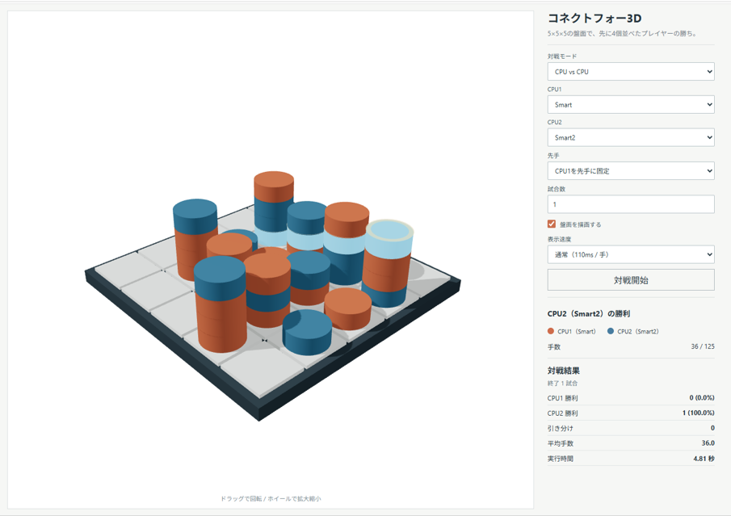
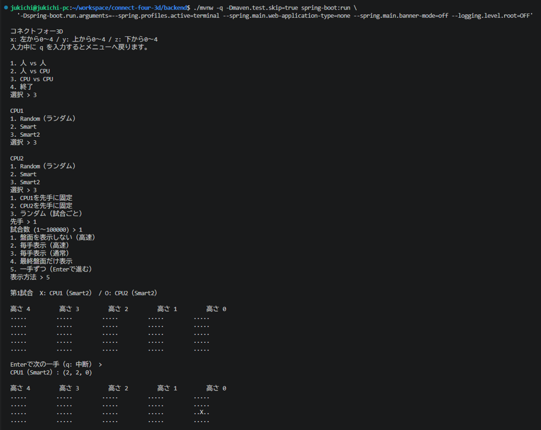
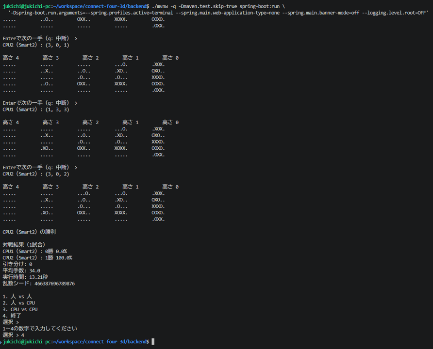

# コネクトフォー3D

5×5×5の盤面に駒を積み、先に4個並べた方が勝ちのゲームです。

人 vs 人、人 vs CPU、CPU vs CPUで対戦できます。CPU同士の連続対戦では、勝率の集計や1手ずつの再生もできます。

## Web版

Java 21、Node.js、npmが必要です。

プロジェクトのルートで実行します。

```bash
./start.sh
```

起動後、ターミナルに表示されるURLをブラウザで開いてください。終了するときは `Ctrl+C` を押します。



## ターミナル版

プロジェクトのルートから実行します。

```bash
cd backend
./mvnw -q -Dmaven.test.skip=true spring-boot:run \
  '-Dspring-boot.run.arguments=--spring.profiles.active=terminal --spring.main.web-application-type=none --spring.main.banner-mode=off --logging.level.root=OFF'
```

メニューから対戦モードを選びます。人が操作するときは `x` と `y` を0〜4で入力します。CPU対CPUの「一手ずつ」表示では、Enterで次の手に進みます。`q` でメニューに戻れます。




